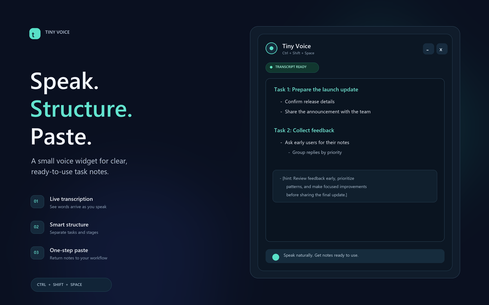

# Tiny Voice

A floating Windows voice widget. Speak, get faithfully cleaned dictation, and paste it into the app you were using.

Developer: **Swamix Global AI Solutions**.



## Install

1. Download **Tiny.Voice_0.3.0_x64-setup.exe** from [GitHub Releases](https://github.com/nikhil-swamix/tiny-voice/releases/latest).
2. Run the per-user installer. It creates a Start menu shortcut and downloads WebView2 if missing.
3. Launch Tiny Voice. The default local pipeline needs no OpenAI key; set one only for GPT Transcribe or the OpenAI formatter. Follow [setup and usage](docs/usage.md).

Windows 10/11 x64 and microphone access are needed. Local formatting requires an already-running SGLang server; local captions require ffmpeg and Handy's cached Nemotron Q8_0 weights. No models are bundled or downloaded automatically. GPT Transcribe (off by default) and the optional OpenAI formatter need internet and an OpenAI API key. The installer is unsigned.

## Use

- **Ctrl+Shift+Space** starts/stops recording, with a 200 ms beep for each action.
- The app stays in the tray while idle. Recording opens the bar at bottom center; it hides ten seconds after copy/paste finishes. Open the expanded view from the tray to browse saved history.
- **Faithful dictation** cleans punctuation and obvious filler without answering or executing spoken requests.
- New output is logical YAML key/value pairs, with at most two mapping levels and readable block scalars for multi-line text. Preserve wording, order, numbers, negation and uncertainty; no invented task steps.
- The formatter prompt is editable in Settings. The strict YAML schema stays built in, so an edited prompt changes instructions, not the response contract.
- Exact YAML is copied/pasted; legacy Markdown history remains readable.
- The widget stays 360 logical pixels wide in both views, with a narrower fixed fallback on small screens. Compact mode shows at most two lines; click the preview or expand button to read the full scrollable output. Hover does not expand it.
- Drag the recording bar to move it. Open Tiny Voice from the tray to expand and browse history. After automatic copy/paste, the bar hides after ten seconds.
- X hides to tray; the tray restores the widget, toggles recording or quits.
- The mic stays ready for up to five minutes. **Release mic** releases it immediately. Idle audio is never recorded or uploaded.

The engine cleans speech without answering questions or executing spoken tasks. The expanded view shows engine status and provider-returned formatting-model metadata.

## Models and data

| Stage | Requested model | Configuration |
| --- | --- | --- |
| Live preview | Handy's `nemotron-speech-streaming-en-0.6b-Q8_0.gguf` | Incremental streaming; cached weights; strict CPU; English only |
| Audio refinement (optional) | OpenAI `gpt-transcribe` | Off by default; when enabled, uploads original saved WebM with vocabulary/language hints; no preview-text substitution |
| Formatting (default) | Local `minicpm5-2b-fp8` | SGLang at `http://127.0.0.1:30000/v1`; thinking disabled; editable prompt; strict logical fields rendered as shallow YAML |
| Optional cloud formatting | `gpt-6.1-sol` | OpenAI profile; low reasoning; same YAML contract |

Read [model documentation](docs/models.md) for configuration, runtime metadata, context and limits.

Recordings are under `%LOCALAPPDATA%\com.local.tinyvoice\recordings`. Live recognition stays on CPU. **GPT Transcribe is off by default**; the finalized Nemotron transcript is formatted instead, with lower recognition accuracy than GPT Transcribe. Turning it on uploads original audio after stop. With the default local profile and GPT Transcribe off, neither audio nor text is sent to OpenAI.

Formatting and history compaction use the selected profile; local SGLang never falls back to OpenAI. An OpenAI key is required only for enabled cloud stages. Deepgram credentials remain preserved but unused.

## Build

Install Node.js, Rust MSVC, Microsoft C++ Build Tools (including CMake), WebView2 and ffmpeg, then:

```powershell
git clone https://github.com/nikhil-swamix/tiny-voice.git
cd tiny-voice
npm ci
npm run desktop:release
npm run installer
```

Production executable: `src-tauri/target/release/tiny-voice.exe`. NSIS installer: `src-tauri/target/release/bundle/nsis`. `npm start` runs desktop development; `npm run desktop` builds an embedded debug app.

The WebView handles capture, streaming, the meter, Markdown and layout. Tauri handles API credentials/calls, local files, hotkeys, clipboard, tray and window controls. Markdown uses `marked` and DOMPurify. Production builds use LTO and stripped binaries.

## Release

Prepare the installer and documentation before publishing; publish the public release last. [0.3.0 release notes](docs/releases/0.3.0.md).

The product image uses illustrative sample text.

## Current widget update

The widget uses a matte, shadow-free AI-block layout with crisp SVG controls, consistent spacing, inward focus rings, and readable text without fading. Compact mode is 176 logical pixels high and limits the preview to two lines. Expanded mode is 520 pixels high, bounded to screen height, with full output and scrollable settings/history. Width never changes with content or view. The slim 2-pixel progress track fills over one minute; recording and elapsed time continue beyond 01:00.

## Processing settings

Settings selects Local SGLang or OpenAI formatting, local endpoint/model, GPT transcription language, the GPT Transcribe switch, and the formatting prompt editor. The local profile is text-only and disables screenshots; OpenAI retains model/reasoning/image controls. Defaults: local MiniCPM5, GPT Transcribe off, images off. The prompt is stored as `formatting-prompt.txt` in the recordings folder; **Restore default** removes the custom file.

Per-recording metadata shows measured transcription and formatting milliseconds. With GPT Transcribe off, timing is the finalized CPU stream drain; cached GPT transcripts show 0 ms. The stage sum excludes capture, history compaction and persistence. Formatting history remains below 500 words.


The toolbar stays visible in compact and expanded views. Expansion is explicit; incoming transcripts and completed output do not resize the widget or override the chosen view. Starting a new recording returns to compact mode. The one-minute timer is a visual guide, not a recording limit; the existing ten-minute safety limit remains.
